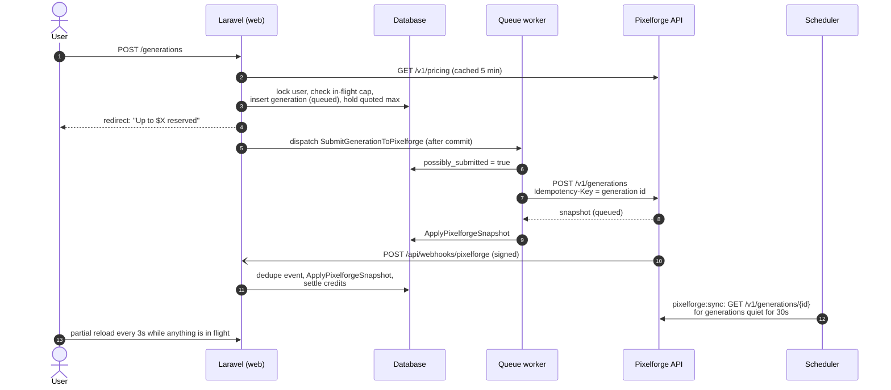
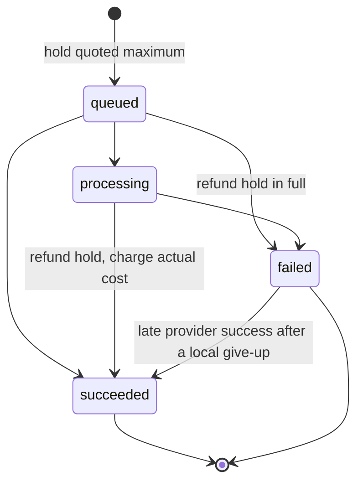

# Pixelforge

A Laravel + Inertia (Vue) app for generating images with the [Pixelforge API](https://pixelforge.promptedit.dev/docs). Users pay for each generation with prepaid credits. Every price is quoted before a generation runs, and a generation that fails costs nothing. Operators get a profit report, checked to the nanodollar against Pixelforge's own usage report.

## Features

- **Generate studio**: prompt, size (1024×1024, 1536×1024, 1024×1536), quality (low / medium / high), and up to 4 reference image URLs. A live cost estimate updates as you type.
- **Upfront pricing**: each generation is quoted as a min–max range from Pixelforge's published price list plus a 25% markup. The quoted maximum is held from the user's balance at submit time.
- **Fair settlement**: on success the user pays the actual marked-up cost, never more than the quoted maximum. On failure the whole hold is returned.
- **Credits**: a $1.00 welcome credit at signup. A "Buy credits" dialog offers $5 / $10 / $25 / $50 packs (simulated; no payment is taken).
- **Live status**: generations move from queued to processing to succeeded/failed without a page refresh.
- **Generation history** with pagination.
- **Admin report** (`/admin/reports`): charged amount, provider cost and profit per UTC day and per user, with a day-by-day reconciliation against `GET /v1/usage`.
- **Robust provider integration**: idempotent submissions, signed and deduplicated webhooks, a polling fallback for missed webhooks, and a shared rate-limit budget.

## Tech stack

| Layer | Choice |
|---|---|
| Backend | PHP 8.3+, Laravel 13, Laravel Fortify (auth) |
| Frontend | Inertia v3, Vue 3, TypeScript, Tailwind CSS v4, Laravel Wayfinder (typed route helpers) |
| Data | SQLite by default; database queue, cache and sessions |
| Quality | Pest, Larastan (PHPStan), Pint, vue-tsc |

---

## Getting started

### Requirements

- PHP 8.3 or newer, with the `sqlite3` and `pdo_sqlite` extensions
- Composer
- Node.js 22 or newer, with npm
- A Pixelforge API key, and a webhook signing secret if you want webhooks

### Install

**Quick setup**

```bash
git clone <repo-url> pixelforge
cd pixelforge
composer setup          # composer install, .env, app key, migrations, npm install, npm run build
php artisan db:seed     # demo accounts (see below)
```

**Step by step**

```bash
composer install
cp .env.example .env
php artisan key:generate
php artisan migrate --seed      # offers to create database/database.sqlite if it's missing
npm install
npm run build
```

Then add your Pixelforge credentials to `.env`:

```dotenv
PIXELFORGE_API_KEY=pf_...
PIXELFORGE_WEBHOOK_SECRET=whsec_...
```

> Use a separate Pixelforge API key for each environment (local, staging, production). The admin report reconciles against `GET /v1/usage`, which reports per API key, so a shared key would mix environments together.

### Run

```bash
composer run dev
```

This single command starts everything the app needs:

| Process | Command | Why it's needed |
|---|---|---|
| Web server | `php artisan serve` | http://localhost:8000 |
| Queue worker | `php artisan queue:listen` | submits generations to Pixelforge |
| Scheduler | `php artisan schedule:work` | runs `pixelforge:sync` every 15 seconds |
| Logs | `php artisan pail` | live log tail |
| Vite | `npm run dev` | hot-reloading frontend |

If you use Laravel Herd, the app is also served at `http://pixelforge.test`. You still need the queue worker and scheduler running, so keep `composer run dev` running too.

### Demo accounts

`php artisan db:seed` creates two verified users. Both use the password `password`.

| Email | Role | Starting credit |
|---|---|---|
| `admin@example.com` | Admin (can open `/admin/reports`) | $25.00 |
| `test@example.com` | User | $10.00 |

New users who register get the welcome credit (`BILLING_SIGNUP_CREDIT`, $1.00 by default).

### Receiving webhooks locally (optional)

Webhooks aren't required for local development. If Pixelforge can't reach you, the scheduled `pixelforge:sync` command picks up status changes within about 30–45 seconds. To get webhooks in real time, expose the app with [ngrok](https://ngrok.com):

```bash
brew install ngrok
ngrok config add-authtoken <your-token>
ngrok http 8000                                   # while `composer run dev` is running
# or, through Herd: ngrok http pixelforge.test:80 --host-header=rewrite
```

Register `https://<your-subdomain>.ngrok-free.app/api/webhooks/pixelforge` as the webhook URL in Pixelforge, and put its signing secret in `PIXELFORGE_WEBHOOK_SECRET`. On ngrok's free plan the URL changes every time ngrok restarts, unless you use a static domain.

### Configuration

Only the first two variables are required. Every other variable has a sensible default.

| Variable | Default | Purpose |
|---|---|---|
| `PIXELFORGE_API_KEY` | none | Bearer token for the Pixelforge API |
| `PIXELFORGE_WEBHOOK_SECRET` | none | HMAC secret for verifying webhook signatures |
| `PIXELFORGE_URL` | `https://pixelforge.promptedit.dev/v1` | API base URL |
| `PIXELFORGE_WEBHOOK_TOLERANCE` | `300` | Maximum webhook age, in seconds, before it's rejected as a replay |
| `PIXELFORGE_REQUESTS_PER_MINUTE` | `50` | Outbound request budget shared by all callers (Pixelforge allows 60) |
| `PIXELFORGE_MAX_CONCURRENT_GENERATIONS` | `3` | Pixelforge's per-account limit on running generations |
| `BILLING_MARKUP_BASIS_POINTS` | `2500` | Markup over provider cost (2500 = 25%) |
| `BILLING_SIGNUP_CREDIT` | `1.00` | Welcome credit in USD |
| `BILLING_MAX_IN_FLIGHT_PER_USER` | `5` | Most generations a single user can have queued or processing at once |

The credit packs are set in [`config/billing.php`](config/billing.php).

---

## How it works

### The generation lifecycle



1. **Quote.** [`GenerationController@store`](app/Http/Controllers/GenerationController.php) validates the input against Pixelforge's own limits. It then calls [`CreateGeneration`](app/Actions/Generations/CreateGeneration.php), which prices the request with [`PriceCalculator`](app/Services/Billing/PriceCalculator.php).
2. **Hold.** In one transaction, `CreateGeneration` locks the user row (so concurrent submits can't race the checks), enforces the per-user in-flight cap, saves the generation and holds the quoted maximum through the [`CreditLedger`](app/Services/Billing/CreditLedger.php). If the balance is too low, nothing is saved.
3. **Submit.** [`SubmitGenerationToPixelforge`](app/Jobs/SubmitGenerationToPixelforge.php) runs after the transaction commits. It waits for one of Pixelforge's three account-wide slots, records `possibly_submitted = true` *before* sending, then posts the stored `request_payload` with the generation's id as the `Idempotency-Key`.
4. **Track.** Status updates can arrive from three places: the create response, webhooks and the polling fallback. All three go through [`ApplyPixelforgeSnapshot`](app/Actions/Generations/ApplyPixelforgeSnapshot.php), the only code that changes a generation's status from provider data.
5. **Settle.** When a generation reaches a final status, credits are settled exactly once: the actual charge on success, a full refund on failure.

### Status rules



Webhooks can arrive twice, late or out of order, so `ApplyPixelforgeSnapshot`:

- locks the generation row, so concurrent deliveries are applied one at a time;
- only moves the status forward (`queued → processing → succeeded/failed`), so a stale `processing` event arriving after `succeeded` is ignored;
- finds the generation by our own id (sent in `metadata.app_generation_id`) before Pixelforge's id. A webhook can arrive before the create request has returned;
- ignores snapshots whose `metadata.app_env` belongs to a different environment.

### Money

All amounts are **integers in nanodollars** (1 USD = 1,000,000,000), handled by [`Nanodollars`](app/Support/Nanodollars.php) on the server and [`money.ts`](resources/js/lib/money.ts) in the browser. Money is never stored or added up as a float. Pixelforge's per-million-token rates divide exactly at this precision.

**Estimate** (before the generation runs, using the token rules in `GET /v1/pricing`; the current values are shown):

- text tokens = ⌈prompt characters ÷ 4⌉, ±15% variance
- image tokens = 765 per reference image
- output tokens = a fixed number per quality and size
- reasoning tokens = a min–max range per quality

The low end of every range gives the minimum price and the high end gives the maximum. The markup is applied and the result is rounded *up* to the next nanodollar.

**Charge** (after success, from the reported `usage` and `rates`):

```
provider cost = Σ tokens × rate ÷ 1,000,000
user charge   = min(provider cost × 1.25 rounded up, quoted maximum)
```

**Worked example.** A 48-character prompt at medium quality, 1024×1024:

| | Text | Output | Reasoning | Provider cost | User price |
|---|---|---|---|---|---|
| Quote min | 10 | 1,100 | 200 | $0.04655 | $0.0581875 |
| Quote max (held) | 14 | 1,100 | 2,000 | $0.06907 | **$0.0863375** |
| Actual | 12 | 1,100 | 1,500 | $0.06281 | **$0.0785125** |

The ledger records a `reservation` of −$0.0863375, then a `reservation_release` of +$0.0863375 and a `charge` of −$0.0785125. The rates are $5 (text), $10 (image), $40 (output) and $12.50 (reasoning) per 1M tokens.

**The ledger.** [`CreditLedger`](app/Services/Billing/CreditLedger.php) is the only code that changes balances. Each balance change is a single atomic `UPDATE`, never a read-then-write, and is recorded in the append-only `credit_transactions` table in the same transaction. Unique indexes act as a backstop:

- `(generation_id, type)`: a generation can be reserved, released and charged at most once each;
- `(user_id, idempotency_key)`: a double-clicked purchase only credits once.

A user's balance therefore always equals the sum of their transactions.

### When things go wrong

[`PixelforgeClient`](app/Services/Pixelforge/PixelforgeClient.php) puts every failed request into one of three groups. The submit job then acts on the group:

| Pixelforge response | Group | What happens |
|---|---|---|
| 2xx | success | Snapshot applied |
| 4xx validation, content policy, invalid key, `429 daily_limit_exceeded` | **Rejected**: nothing was created | Failed locally, hold refunded |
| `429` rate limit, `503 overloaded` | **Transient**: nothing was created | Retried after `Retry-After`. If Pixelforge is still overloaded after three backoffs (5s, 15s, 45s), the generation fails for free |
| `409`, other 5xx, timeout, connection error, unreadable body | **Ambiguous**: it *might* exist and be billed | Hold kept. The same payload is replayed with the same `Idempotency-Key`, with exponential backoff capped at 60s |

**The key rule:** a generation that *might* exist on Pixelforge is never failed for free. If an earlier attempt was ambiguous, even a later "rejected" answer is not trusted. The job keeps replaying until Pixelforge confirms the generation one way or the other. If Pixelforge reports success after we had already given up (see the sync section below), the cost is still recorded with `chargeWithoutHold`, so the books stay complete.

Other safeguards:

- **One shared request budget.** Every outbound call takes from one per-minute limit (50/min, below Pixelforge's 60), so background polling can never crowd out submissions.
- **Account concurrency.** The job waits for one of Pixelforge's three running-generation slots instead of collecting `429` responses.
- **Job settings.** The job is unique per generation, retries for up to 30 minutes, and is dispatched only after the database commit.
- **Pricing fallback.** The price list is cached for 5 minutes. If Pixelforge is unreachable, the last-known-good list is used, so the studio keeps quoting.

### Webhooks

`POST /api/webhooks/pixelforge` is handled by [`PixelforgeWebhookController`](app/Http/Controllers/PixelforgeWebhookController.php), behind [`VerifyPixelforgeSignature`](app/Http/Middleware/VerifyPixelforgeSignature.php):

1. **Verify the signature.** The `Pixelforge-Signature: t=<unix>,v1=<hex>` header must match `HMAC-SHA256("<t>.<raw body>", secret)`, compared in constant time. Requests older than 5 minutes are rejected, so a captured request can't be replayed.
2. **Deduplicate.** The event is inserted into `pixelforge_webhook_events` keyed by its unique event id. A repeat delivery is a no-op.
3. **Apply.** `generation.*` events go through `ApplyPixelforgeSnapshot`, in the same transaction as step 2.

Any error rolls back the whole transaction and returns a 5xx, so Pixelforge retries the delivery.

### Background sync (`pixelforge:sync`)

Webhooks are not guaranteed to arrive, so [`SyncPixelforgeGenerations`](app/Console/Commands/SyncPixelforgeGenerations.php) runs every 15 seconds:

| Situation | Action |
|---|---|
| In flight, Pixelforge id known, no update for 30s | Ask Pixelforge for the current status (up to 5 per run, oldest first) |
| Outcome unclear, no update for 2 min | Re-dispatch the submission (a no-op while a retry is already queued) |
| Outcome unclear for 24 h | Give up: fail it and refund the hold. A later success is still charged |
| Never sent, no update for 40 min | Fail it for free (the job's retry window has passed) |

### Live updates in the browser

[`useLiveGenerations`](resources/js/composables/useLiveGenerations.ts) polls every 3 seconds, and only while at least one visible generation is queued or processing. Each poll is an Inertia partial reload of just the generations and the credit balance. Polling pauses in background tabs and never overlaps. The cost estimate is computed in the browser by [`resources/js/lib/pricing.ts`](resources/js/lib/pricing.ts), which mirrors the PHP `PriceCalculator` exactly.

### Admin report

[`ReportController`](app/Http/Controllers/Admin/ReportController.php) (admin users only, via the `viewAdminReport` gate) groups succeeded generations by `billed_on`, the UTC day they completed, which is the day Pixelforge bills them. It shows:

- totals, per day and per user: number of generations, amount charged to users, Pixelforge's cost, and profit;
- **reconciliation**: our provider cost next to Pixelforge's `GET /v1/usage` for each day, flagged if the two differ by even one nanodollar. This section is loaded as a deferred prop, so the rest of the page renders even if Pixelforge is slow or down.

Report dates are UTC days. The range defaults to the last 30 days and is capped at 92, the longest range `/v1/usage` accepts.

---

## Project layout

```
app/
├── Actions/Generations/
│   ├── CreateGeneration.php          quote, hold credits, queue submission
│   ├── ApplyPixelforgeSnapshot.php   the only provider-driven status change; settles credits
│   └── FailGenerationLocally.php     free failure, only when Pixelforge can't have it
├── Console/Commands/
│   └── SyncPixelforgeGenerations.php polling and recovery fallback
├── Jobs/
│   └── SubmitGenerationToPixelforge.php  idempotent submit and outcome handling
├── Services/
│   ├── Pixelforge/                   API client, snapshot DTO, price list, exceptions
│   └── Billing/                      PriceCalculator, CreditLedger
├── Http/
│   ├── Controllers/                  Generation, CreditPurchase, PixelforgeWebhook, Admin/Report
│   └── Middleware/VerifyPixelforgeSignature.php
├── Models/                           User, Generation, CreditTransaction, PixelforgeWebhookEvent
├── Enums/                            GenerationStatus, ImageSize, ImageQuality, ...
└── Support/Nanodollars.php           integer money helpers
config/billing.php                    markup, credit packs, signup credit, per-user cap
config/services.php                   Pixelforge credentials and limits
resources/js/
├── pages/generations/                Create (studio), Index (history)
├── pages/admin/Report.vue
├── components/generations/, components/credits/
├── composables/useLiveGenerations.ts
└── lib/pricing.ts, lib/money.ts      browser mirror of the pricing maths
routes/web.php, routes/api.php, routes/console.php
```

The typed route helpers in `resources/js/actions` and `resources/js/routes` are generated by Wayfinder during `npm run dev` and `npm run build`, and are git-ignored.

---

## Extending the app

### Common changes

| You want to… | Change |
|---|---|
| Change the markup, welcome credit, credit packs or per-user cap | [`config/billing.php`](config/billing.php) or the `BILLING_*` variables |
| Add an image size or quality | Add a case, with its label (and dimensions, for a size), to [`ImageSize`](app/Enums/ImageSize.php) or [`ImageQuality`](app/Enums/ImageQuality.php). The studio's options and the validation rules come from the enums automatically. The price comes from Pixelforge's price list, and `PriceCalculator` throws if the list has no entry for the new value |
| Handle a new webhook event type | Events are always stored and deduplicated. Add handling in [`PixelforgeWebhookController`](app/Http/Controllers/PixelforgeWebhookController.php); today only `generation.*` events are applied |
| Take real payments | Replace the simulated purchase in [`CreditPurchaseController`](app/Http/Controllers/CreditPurchaseController.php) with a payment provider, and call `CreditLedger::purchase()` from its confirmation webhook. `purchase()` is already idempotent per key |
| Add another way to change balances (refunds, promotions) | Add a method to `CreditLedger` and a matching `CreditTransactionType` case, so every balance change stays in the ledger |
| Show more generation fields in the UI | Add them to [`GenerationResource`](app/Http/Resources/GenerationResource.php) and [`resources/js/types/generation.ts`](resources/js/types/generation.ts) |

### Rules to keep

These rules are what keep the money correct. Any change to billing, webhooks or submission should preserve them, and the tests cover each one.

1. **Money is integer nanodollars.** Convert at the edges with `Nanodollars::fromDecimal()` and `toDecimal()`, never floats.
2. **Only `ApplyPixelforgeSnapshot` changes status from provider data, and only forward.** Don't update `status` directly in controllers or jobs.
3. **Never fail a `possibly_submitted` generation for free.** Pixelforge may have created and billed it. Use `FailGenerationLocally::handle()`, which enforces this; `abandon()` is only for the 24-hour timeout.
4. **Every balance change goes through `CreditLedger`, inside the caller's transaction.**
5. **Replay `request_payload` unchanged, with the generation id as the `Idempotency-Key`.** Changing the body on a retry would make Pixelforge treat it as a different request.
6. **Every outbound Pixelforge call goes through `PixelforgeClient`,** so the shared request budget and error grouping apply.

---

## Testing and code quality

```bash
php artisan test                 # Pest test suite
composer test                    # Pint check + PHPStan + tests
composer lint                    # fix PHP formatting with Pint
npm run types:check              # vue-tsc
npm run check                    # frontend lint and format check
```

The suite never calls the real Pixelforge API: stray HTTP requests fail the test, and the price list comes from [`tests/Fixtures/pixelforge/pricing.json`](tests/Fixtures/pixelforge/pricing.json). Shared helpers in [`tests/Pest.php`](tests/Pest.php) build Pixelforge snapshots and send correctly signed webhooks. Coverage includes the money calculations, every submission outcome, duplicate and out-of-order webhooks, signature checks, sync recovery, purchases and the admin reconciliation.

---

## Deploying

The app needs three processes in production:

1. **Web server:** PHP-FPM, Laravel Cloud, Forge, or similar.
2. **Queue worker:** `php artisan queue:work`. Without it, generations stay queued forever.
3. **Scheduler:** `php artisan schedule:work`, or a cron entry running `php artisan schedule:run` every minute. This drives `pixelforge:sync`.

Checklist:

- [ ] `APP_ENV=production`, `APP_DEBUG=false`, `APP_URL` set to the public URL
- [ ] A production-only `PIXELFORGE_API_KEY`
- [ ] Webhook URL `https://<your-domain>/api/webhooks/pixelforge` registered in Pixelforge, with its secret in `PIXELFORGE_WEBHOOK_SECRET`
- [ ] A cache store that supports atomic locks (the default `database` store does)
- [ ] `php artisan migrate --force` and `npm run build` on each deploy
